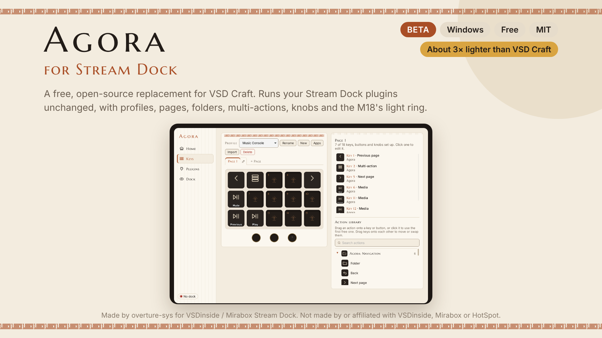

# Agora



A free, open-source (MIT) app for VSDinside / Mirabox Stream Dock devices: a replacement for VSD Craft that runs your existing Stream Dock plugins unchanged.

> **Beta. Tested on the Stream Dock M18 only.** The other models below are built from public notes and haven't been tried on real hardware yet. If you have one, please try it and open an issue saying what works and what doesn't.
>
> Not made by or affiliated with VSDinside, Mirabox, HotSpot, Elgato or Corsair.

If Agora is useful to you, you can support it on [Ko-fi](https://ko-fi.com/overturesys).

## Install (Windows 10 or 11)
1. Download `Agora-<version>-setup.exe` from the [releases page](https://gitlab.com/overture-group1/agora/-/releases).
2. Run it. It installs for you only, so no administrator rights are needed. Windows may warn about an unknown publisher because the installer isn't signed; choose "More info", then "Run anyway".
3. Close VSD Craft (Stream Dock), then start Agora from the Start menu. Agora and VSD Craft can't use the dock at the same time. Quitting Agora from its tray icon hands the dock back.

Your keys, profiles and settings live in `%APPDATA%\Agora` and are kept when you uninstall or update.

## What it does
- **Docks:** Stream Dock M18 (tested). Also M18 V3, 293V3, 293S (three versions), N3, N4 / N4 Pro and XL (untested).
- **Also works with Elgato Stream Deck (early, untested):** Mini, Mini MK.2, Stream Deck (original and MK.2), XL and the Neo's keys. Quit the Elgato Stream Deck app first. Several devices can be plugged in at once; each keeps its own profiles.
- **Keys:** drag an action onto a key, button or knob. Your own title, title position, colour and icon on any key.
- **Profiles, pages and folders.** A profile can follow an app: it comes up while that app is in front.
- **Agora's own actions:** open an app, file or folder; website; hotkey (press the keys to record them); type text; media keys; quick controls (sleep, lock, show desktop, screen off, microphone mute, switch screens); quick tools (Calculator, emoji panel, Task Manager, search and more); close window; mouse click, scroll and move; browser back, forward, refresh and tabs; saved passwords (kept in Windows Credential Manager); soundboard; UDP network messages; web requests (Home Assistant, webhooks); run a PowerShell command and show its output; snippets picker; window tools (next screen, snap, maximise, keep on top); sound output switching and per-app volume; hotkey switch; dock brightness, dock sleep and the light ring; next, previous or go to page, page indicator; switch profile (or the next or previous one); folder.
- **Monitor keys:** live CPU, memory, disk, GPU and GPU memory readings, and your public or local IP address.
- **Time keys:** clock, timer, stopwatch and counter.
- **Hold for a second action:** any key can run a different list of actions when held for half a second.
- **Multi-actions:** run several actions in order with pauses, a Toggle that alternates between two lists, a Random action that picks one, and a Knob action for turning left, turning right and pressing.
- **Plugins:** runs Stream Dock plugins unchanged (Node.js, HTML and .exe plugins), with their own settings panels. Knob actions get dial turns, presses and strip taps. Tested with Winged Keys and Shannon Keys.
- **Undo:** removing a key, page, profile or plugin can be undone for a few seconds (Undo, or Ctrl+Z).
- **Dock:** screen brightness, the M18's light ring (one colour, or paint it light by light), start with Windows, a screen saver (Matrix rain, the Agora temple, starfield, big clock or your own GIF) and an intro when the dock connects.
- **Intro:** the Agora temple builds itself when the app opens, or play your own video.
- **Open keys** take the app's own icon.
- **VSD Craft import:** brings in your M18 profiles from VSD Craft. Agora only reads VSD Craft's files and never changes them.

Plugins are read from `%APPDATA%\Agora\plugins`, and, if you switch it on in Plugins, from VSD Craft's plugin folder (`%APPDATA%\HotSpot\StreamDock\plugins`), read only. Plugin output goes to `%APPDATA%\Agora\logs`.

Node.js plugins need Node.js 20 or newer. Agora uses, in order: the `AGORA_NODE` environment variable, `node\node.exe` next to `agora.exe`, the Node 20 that VSD Craft installs, then `node` on PATH. VSD Craft's Node comes before PATH because Stream Dock plugins are built for it, and some carry add-ons that only load on that Node version.

Agora starts a plugin only once one of its actions is on a key, so plugins you have installed but don't use cost nothing.

## Not done yet
- "Open several apps", a dedicated hotkey switch and a carousel multi-action.
- Importing VSD Craft profiles made for docks other than the M18.
- If Agora crashes, plugins it started may keep running until you sign out.

## Layout
```
crates/agora-device   device layer: the driver, models, key images, dock worker thread
crates/agora-host     plugin host: manifests, Stream Dock SDK over WebSocket, key faces
crates/agora-m18      M18 test tool
src-tauri             the app (Tauri 2, Rust)
ui                    the app's screens (Svelte 5 + TypeScript)
installer             the Windows installer (NSIS)
assets                artwork: cover, 16:9 preview and avatar
```

## Build
Needs Rust (stable) and Node 20+. On Windows the WebView2 runtime is already part of Windows 10/11.

```
cargo test -p agora-device               # protocol tests, no dock needed
cargo test -p agora-host                 # plugin host tests (Node 22+ on PATH for the end-to-end ones)
cargo run -p agora-m18 -- test           # needs an M18 plugged in
cd ui && npm install && cd ..
cargo install tauri-cli --version "^2"
cargo tauri dev                           # app with live reload
cargo tauri build                         # installer in target/release/bundle
```

Cross-building the Windows app from Linux also works:
`rustup target add x86_64-pc-windows-gnu`, install `mingw-w64`, build the UI, then
`cargo build --release -p agora --features custom-protocol --target x86_64-pc-windows-gnu`.
Ship `agora.exe` with `WebView2Loader.dll` from the same folder. To make the installer, put both in one folder and run
`makensis -DVERSION=<version> -DSRC=<that folder> installer/agora.nsi`.

## Sources
Device protocol from our own M18 tests plus MIT / public-domain notes: bidoofgoo/streamdock-m18 (PROTOCOL.md), bitfocus/companion-surface-mirabox-stream-dock (model tables for the other docks), stevemurr/streamdock. Plugin protocol from the Stream Dock SDK (sdk.key123.vip). No OpenStreamDeck or OpenDeck (GPL) code is used.

Stream Deck support uses the [elgato-streamdeck](https://crates.io/crates/elgato-streamdeck) crate (version 0.14.0, MPL-2.0, source at https://github.com/OpenActionAPI/rust-elgato-streamdeck), unchanged. Its files stay under the MPL-2.0 (https://mozilla.org/MPL/2.0/); the rest of Agora is MIT.

## License
MIT. Copyright (c) 2026 overture-sys. Built by overture-sys with Claude.
